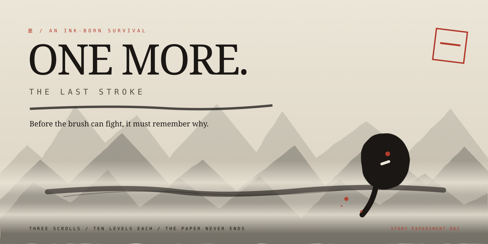

# ONE MORE



<p align="center"><strong>THE LAST STROKE</strong> · AN EXPERIMENTAL SEVEN-FRAME CINEMATIC PROLOGUE<br/>
The ink remembers every stroke.</p>

> **Experimental story branch:** [experiment/the-last-stroke](https://github.com/itsnotalwin/ONE_MORE/tree/experiment/the-last-stroke). This is a creative preview, **not the live production release**. The current original game remains on [main](https://github.com/itsnotalwin/ONE_MORE/tree/main).

**Try the branch preview:** [Open the experimental web build](https://raw.githack.com/itsnotalwin/ONE_MORE/story-preview/index.html) through raw.githack, a **third-party preview proxy, not GitHub Pages**. It may ask you to confirm before showing HTML, and updates can take a few minutes to appear. The owner approved using the public [ONE MORE Pages URL](https://itsnotalwin.github.io/ONE_MORE/) to test the `development` branch. **Action still required:** an automated source-switch attempt was rejected by GitHub (HTTP 403: insufficient settings privileges). In [Settings → Pages](https://github.com/itsnotalwin/ONE_MORE/settings/pages), set **Deploy from a branch → development → / (root) → Save**. Do not interpret successful branch checks as proof the live source was switched.

## A story hidden beneath the paper

Before the world had a name, there was paper. The Painter imagined mountains, rivers, and living things in a single breath. But ink seeped through the other side, and abandoned marks learned to move. Afraid of these mistakes, the Painter tried to wash everything away. One unfinished brushstroke survived.

**You are that stroke.**

The prologue **automatically starts on every page load, without requiring a tap**. It is a **61-second, seven-frame playable cinematic** rendered by the browser: ink-wash mountains, inverted night scrolls, water erasure, a final vermilion mark, and a surviving brush spirit. It uses no stock video, no remote animation model, and no MP4 download. The player can skip it, advance frames, enable subtle synthesized sound, or replay from the title. The cinematic now features brushstroke reveals, living ink motes, scene dissolves, and correct inverted-ink Night Scroll contrast. Audio remains off until explicitly enabled, as required by mobile autoplay restrictions. A **Chronicle** unlocks the complete fiction as your campaign progresses.


## Three scrolls, one unfinished fate


The story works with the existing campaign, not in place of it. The game already has **3 worlds × 10 independent levels × 10 waves**. Every level begins a fresh build, upgrade picks follow each cleared wave, and permanent campaign unlocks survive failed runs. The experimental cinematic never alters game physics or enemy balance.

**Living project documents:** [Full GAME BIBLE, story, art/sprite/animation atlas and Kanban roadmap](docs/GAME_BIBLE.md) · [Original style protection contract](DESIGN.md) · [Research notes](docs/RESEARCH.md).

*All images in this README are **authored SVG illustrations** made for documentation and direction, not fabricated gameplay screenshots. Real screenshots are explicitly on the QA checklist.*

---


*An ink-born survival. No walls. No arena. One endless sheet of washi.*

**ONE MORE** is a zero-dependency, zero-build browser game written in vanilla
HTML/CSS/JS. You are a brush spirit walking an unbounded scroll of washi
paper — Vampire-Survivors style, the camera follows you and the paper never
ends. Your brush fires ink at the nearest threat on its own; your only job
is to *not be erased*.

The journey is **three scrolls (worlds), ten separate levels per scroll, ten
waves per level**. Each level is a fresh run and a harder challenge. Clear ten
waves to seal a level and unlock the next; clear Level 10 to unroll the next
world. Complete all three scrolls to seal the campaign. **THE ENDLESS SCROLL**
remains a separate replayable mode, cycling through the original three papers
as difficulty compounds.

The whole game is painted like living sumi-e: every creature is a wobbling
blot of ink animated with hand-drawn line boil, every kill splatters real
ink that **permanently stains the paper** — the world slowly becomes a
painting of your fight. Wave banners are stamped in kanji. The one drop of
color belongs to the vermillion seal.

---

## The three scrolls

| Sheet | Paper | The beasts that live there |
|---|---|---|
| 一 FIRST WASH | Pale washi, soft fibers | BLOT, SPEAR, SPIT, MOTH, DRIP, WISP, BRUTE |
| 二 NIGHT SCROLL | Near-black paper, the ink turns white | WISP, SHADE, MOTH, KAGE, STILT, SPEAR, BLIP |
| 三 CINNABAR FIELD | Vermillion-washed paper, red drips dry underfoot | BRUTE, SPIT, ONI, CRANE, DRIP, TITAN, KAGE |

**Each level is an independent ten-wave run.** Wave 10 summons a
**GUARDIAN**, with a stronger world boss on Level 10, Wave 10. Wave 5 is a
**SURGE**. New worlds unlock only after all ten levels of the preceding world
are cleared. The player can replay completed levels, and losing never removes
permanent unlocks.

Each scroll also now features a distinct encounter pattern, using the original
creatures and brush rendering: **SPLIT BLOOM** (FIRST WASH, waves 6/9),
**PHANTOM AMBUSH** (NIGHT SCROLL, waves 3/6/9) and **CRIMSON RUSH**
(CINNABAR FIELD, waves 5/9).

## How to play

Choose **THE JOURNEY**, select an unlocked scroll, then choose the next
unlocked level. Survive ten waves to seal it; between waves choose one of three
brush upgrades. These upgrades reset on every new level, while completed
levels stay saved in your browser.

| Input | Action |
|---|---|
| `W A S D` / Arrow keys | Move — the sheet is endless, walk anywhere |
| Auto-fire | Engaged — the brush always flicks at the nearest blot |
| `1` `2` `3` | Select an upgrade (press again, or `Enter`, to deploy) |
| `P` / `Esc` | Pause |
| `M` | Toggle sound |
| Touch | Drag anywhere for a virtual joystick |

**The fourteen ink-born**

| Name | Behavior |
|---|---|
| BLOT | Slow, relentless drifter |
| SPEAR | Telegraphs, then lunges in a straight line |
| SPIT | Keeps its distance, inflates, and lobs ink globs back at you |
| MOTH | Erratic flicker — never holds a course, bursts in jolts |
| DRIP | Dies into two fast blips |
| SHADE | Dissolves into flecks, blinks at your back, pounces |
| BRUTE | Hatched, dripping bruiser. Slow. Very hard to kill |
| WISP | Weaves sideways as it closes in |
| KAGE | Circles you like a stain, then cuts straight through in a dash |
| STILT | A tall sniper — draws a hair-thin line at you, then fires a needle |
| TITAN | The mother of blots — sheds her brood as she bears down |
| ONI | Horned bruiser — winds up, then bulldozes straight ahead |
| CRANE | Folded paper that swoops past in long, fast arcs |
| BLIP | A fast shard, born from deaths and titans |

SPIT's globs and STILT's needles are dodgable — watch for hollow rings and
the drawn line. SHADE leaves a stain where it vanished and where it
reappears; read the paper.

**The brush arts — 19 upgrades**, including four weapons:

- *Strokes*: Quick Hand, Bitter Ink, Twin Stroke, Through Mist, Flick,
  Fleeting Foot, Thick Ink, Red Seal, Ink Burst, Echo Stroke, Ink Orbit,
  Black Tide, Wet Paper, Crimson Tip, Paper Ward
- *Weapons* (marked 武 in vermilion on their cards):
  **Folded Fan** — a snapping spray of paper blades;
  **Ink Trail** — the smears you leave behind keep biting;
  **Spirit Scribes** — lesser brushes that wake and hunt on their own;
  **Ink Knots** — living brush threads bind a small cluster, slow them, and deal one delayed point of damage per target.

---

## Deploy to GitHub Pages

ONE MORE is a static website with no build step. To publish it directly,
open **Settings → Pages** and choose **Deploy from a branch**, with
branch `main` and folder `/ (root)`. GitHub Pages then serves `index.html`.
If you already use a separate Pages deployment setup, keep that existing
configuration. This repository does not require a server or secrets.

On a feature branch, use the branch's code for local previews; nothing is
published from a feature branch until the relevant changes land in your
configured deployment branch.

## Run locally

No build step. Any static server works:

```bash
python3 -m http.server 8000
# then open http://localhost:8000
```

(Opening `index.html` directly from disk also works.)

## Project structure

```
one-more/
├── index.html                  # shell: canvas + all screens + ink wobble filters
├── css/
│   ├── style.css               # the original sumi-e design system
│   └── intro.css               # cinematic + Chronicle only
├── js/
│   ├── config.js               # tuning: areas, enemies, waves, upgrades, ranks
│   ├── campaign.js             # persistent world/level unlocks
│   ├── audio.js                # synthesized ink sound kit (splats, taiko, gong)
│   ├── ui.js                   # DOM screens, HUD, kanji numerals, upgrade cards
│   ├── game.js                 # camera, areas, waves, entities, weapons, flow
│   ├── render.js               # original gameplay renderer
│   ├── intro.js                # optional seven-scene canvas film + Chronicle
│   └── main.js                 # bootstrap, input, game loop, wiring
├── .github/
│   └── workflows/
│       ├── test.yml            # progression + style-source checks on PRs
│       └── story-preview.yml   # experimental tests + downloadable preview bundle
├── tests/
│   ├── progression.test.cjs    # existing campaign regression tests
│   └── story.test.cjs          # optional prologue and archive regression tests
├── docs/
│   ├── GAME_BIBLE.md           # canon lore, technical atlas, roadmap checklist
│   ├── RESEARCH.md             # art, accessibility, hosting choices
│   └── images/                 # original SVG illustrations (not screenshots)
├── DESIGN.md                   # frozen visual style references and rules
├── LICENSE
└── README.md
```

## Tuning the scrolls

All balance knobs live in `js/config.js`:

- `AREAS` — the three sheets: name, kanji, paper theme, difficulty multipliers,
  spawn roster and each sheet's Guardian
- `CFG.wave` — waves per level, spawn budgets, surge cadence, elite scaling
- `CFG.endless` — how fast the endless paper grows teeth after sheet three
- `ENEMIES` — hp, speed, size, score and the wave each type enters
- `UPGRADES` — the pool of strokes and weapons, and their level caps
- `CFG.world` — spawn padding, stain cap and fade, ambient mark density
- `CFG.ranks` — waves-cleared thresholds for the end-of-run seal

Campaign unlocks (`om_campaign_v1`), high score, run counter and mute preference
persist in `localStorage` —
no backend, no accounts, no tracking. GitHub Pages serves static files
only, and the game is 100% client-side by design.

## Test

Run `node --test tests/*.test.cjs` (Node.js 18+). The suite checks
all 30 stage clears, 300 wave transitions, sequential unlocks, world-specific
enemy patterns, final bosses, storage fallback, Endless, and frozen original
renderer/audio/CSS contents. It is a headless logic test; actual browser visual
checks on mobile and desktop are still required before deploying.

For exact original appearance, consult [DESIGN.md](DESIGN.md) and its
commit-pinned references. Existing enemy illustrations, combat ink effects and
animations are preserved. Story scenes use additional **separate, cached Canvas painting**.

**Preview hosting:** GitHub Pages supports one configured publishing source per
repository. We intentionally **have not changed Pages away from `main`**. This
branch's third-party raw.githack preview is for testing, not a substitute for
a separately configured first-party staging deployment.

## Tech

- Vanilla JavaScript (ES6+), Canvas 2D, WebAudio API
- Procedural brush rendering: tapered strokes, wobbling blobs, splatter
  stamps, dry-brush streaks, line-boil animation — no imported combat image assets
- Unbounded world: camera-follow, rectangle-accurate off-screen spawning,
  sprite-cached world-space stains, hash-grid ambient paper marks
- Zero dependencies, zero build step, zero telemetry
- Fonts: Zen Antique, IBM Plex Mono (Google Fonts CDN, with system
  fallbacks if offline)

## License

MIT — see [LICENSE](./LICENSE).
