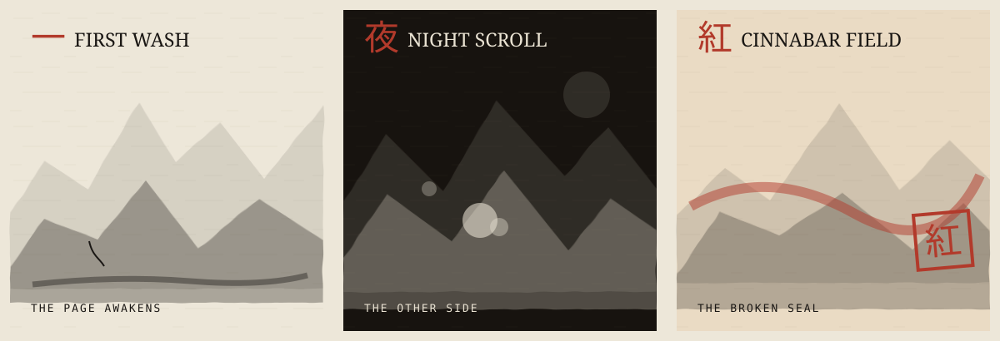
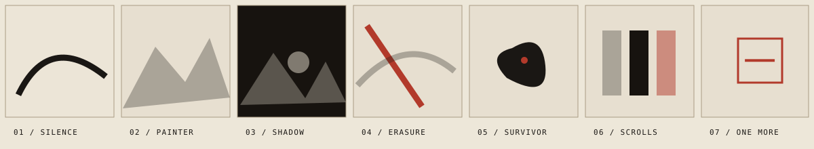

# ONE MORE — Game Bible & Living Production Board

> **Edition:** Story Experiment 01, "The Last Stroke"  
> **Branch:** [experiment/the-last-stroke](https://github.com/itsnotalwin/ONE_MORE/tree/experiment/the-last-stroke)  
> **Status:** Experimental, *not approved for production*. The default \`main\` site is the gameplay reference.  
> **Owner's direction:** Keep existing sumi-e/washi identity, procedural sprites, combat systems, animations and UI; add storytelling without reauthoring them.

## 1. Vision

**ONE MORE** is a zero-dependency, mobile-friendly, single-player survival roguelite. A living brush spirit traverses an unbounded sheet of paper while auto-firing ink at strange living stains. Every enemy leaves a mark. A player's run gradually becomes its own abstract painting.

**Design pillars:** (1) one more wave, one more try; (2) a handmade sumi-e motion language; (3) meaningful survival and readable threats; (4) replayable levels and progressively revealed lore; (5) near-zero installation friction on mobile.

**Tone:** mournful, beautiful, restrained, eerie but humane. **Avoid:** generic RPG fantasy, neon game UI, flashy VFX packs, voiced copyrighted music, stock textures, new engines, untested monetization mechanics.

## 2. Canonical state of the game

### Existing implementation

- Browser stack: plain HTML5, CSS, JavaScript, Canvas2D and synthesized WebAudio. Zero build step and no third-party runtime packages.
- Static hosting: the public GitHub Pages URL is currently being built successfully from `development`, as confirmed by [GitHub Actions](https://github.com/itsnotalwin/ONE_MORE/actions/runs/39126685811). The normal `main` source remains an available rollback branch.
- Movement: WASD, arrow keys or touch joystick. Player auto-targets and shoots. Pause with P/Escape, mute with M. Pick one of three cards between waves; deploy using 1/2/3 and Enter/click.
- World architecture: **3 worlds × 10 separate levels × 10 waves each = 30 levels / 300 authored wave slots**. Wave 10 has a Guardian, with a stronger world boss at level 10.
- Waves 1–9 end with a three-upgrade choice. There is **no XP-based leveling yet**: do not advertise XP pickups as existing.
- A run loses temporary weapon upgrades on death or when completing a level. The campaign saves the number of completed levels in each world to \`om_campaign_v1\` on the player's device; legacy best score and run counter remain separate.
- Endless Scroll remains selectable from the title and increases difficulty across cycling paper environments.
- Difficulty increases with wave and level and differs by world via multipliers. Splitting, ambush, and charger encounter mixes distinguish the present worlds.

### What Story Experiment 01 adds

- An optional **seven-shot, 61-second animated short film**, drawn continuously in \`js/film.js\` and directed by \`js/intro.js\`. It plays automatically with timed shots and subtitles, a moving camera and animated characters; Escape/Skip ends it immediately.
- The film **autoplays on every page launch** without a start cover or session-based suppression. It remains skippable and replayable from the title; audio is opt-in.
- Optional synthesized tonal cues, **off by default** and activated only by player gesture.
- The Chronicle, a readable five-part story archive, with later chapters gated by existing campaign completion: 0, 10, 20, 30 levels.
- CSS and original SVG illustrations matching the original paper/ink palette. No gameplay weapon balance, sprites or enemy behavior changed in the experiment.

## 3. Entire story: THE LAST STROKE

### Central premise and symbolic rules

An unseen **Painter** imagined an infinite world on endless washi. The brush moved forward; every line gained life. But ink bled through the paper, and marks the Painter rejected emerged on the reverse as restless creatures. The Painter attempted to wash away the "mistakes," unknowingly dissolving the world as well. One unfinished mark remained, refusing erasure. That mark became the player, the **Last Stroke**, a small spirit carrying the last living brush.

**Ink** is memory. **Paper** is the world. **Water** is fear of imperfection. **Vermilion** marks a false ending, a seal stamped too soon. The player is not morally pure; its attacks stain the world too. Surviving means accepting that life leaves marks.

The Painter is deliberately neither all-good nor an evil final villain. This is a story about creation, regret and the courage to continue unfinished work. Never narrate it as a historical Japanese legend. It is original fiction borrowing a visual language from sumi-e.

### The Last Stroke: seven-shot animated short film

| # | Film shot | Narrative beat | Action animated in real time |
|---|---|---|---|
| 01 | Before the First Mark | A drop falls into a world before language. | Animated ink drop, liquid splash and stroke literally drawing across paper |
| 02 | A World in One Breath | The Painter makes the first landscape. | A bamboo brush moves across the camera while mountains reveal and the river is drawn |
| 03 | Every Mark Cast a Shadow | Rejected marks awaken on the paper's reverse side. | A succession of independent ink beasts coalesces, floats and writhes in living night |
| 04 | The Water Came | Fear drives the Painter to erase the world. | A moving water-front physically washes the screen; particles dissipate; red fracture appears |
| 05 | One Stroke Refused | The last living mark reforms. | Dozens of ink flecks converge into the animated protagonist, then travel past pursuing shadows |
| 06 | Three Sheets. One Fate. | The journey's three worlds are revealed. | Each scroll unfurls on a separate beat with moving native enemy silhouettes |
| 07 | The Page Is Not Finished | The Last Stroke will keep drawing. | ONE MORE letterforms appear through an animated ink wipe; a vermilion seal strikes and breaks into flecks |

**Accessibility:** the same text is available in HTML; reduced-motion systems remove camera drift and text entrances; story can be skipped at any moment; audio never starts without opt-in.

### ACT I: FIRST WASH, "The Page Awakens"

An ordinary pale sheet covered with fibers. At first the creatures appear mindless, but some split, suggesting that erasing a thought multiplies the very thing one fears. The player learns to control ink rather than merely aim. **Act revelation:** stains are not corruption; they are evidence the world existed.

**World-level arc proposal, not yet implemented in combat story beats:**  
Levels 01–02: the first blot; 03–04: other marks respond; 05–06: the divided droplet; 07–08: first evidence of another side to the page; 09: ink echoes; 10: the First Guardian, a mass of attempts that were abandoned too soon.

### ACT II: NIGHT SCROLL, "The Other Side"

The page is inverted. Ink becomes pale and the night paper is almost black. Kage, Shade and Stilt embody choices that were never made, blinking behind the player or attacking from distance. They are not demons from an outside mythology. They are the hidden drafts of this same world.

**Act revelation:** the Painter feared making the wrong mark more than making none. The survivors of the reverse side have been trying to cross into life.

**World-level arc proposal:**  
Levels 01–02: reversal; 03–04: the shadow mirrors the brush; 05–06: a missing memory; 07–08: the Painter's attempted correction; 09: the nearly erased name; 10: the Night Guardian, a shadow of the hand itself.

### ACT III: CINNABAR FIELD, "The Broken Seal"

The third scroll was originally the Painter's signature. Cinnabar red was stamped over an unfinished work. Oni, Titan, the Crane, and red ink traces defend a wound at the edge of the paper. Their aggression is part of a protective mechanism, not mindless evil.

**Act revelation:** the "Great Erasure" was caused by fear, not hatred. The Painter vanished while trying to finish what should have stayed open.

**World-level arc proposal:**  
Levels 01–02: red wash; 03–04: the guarded seal; 05–06: the Titan brood and the price of control; 07–08: the lost signature; 09: the Last Stroke accepts imperfection; 10: break the seal and reveal the unbounded page.

### Epilogue: THE ENDLESS SCROLL

There is no final boss called the Painter. The act of removing the premature seal completes the story. The world has room for uncertainty again. Endless mode becomes thematic: not punishment, but permission to keep making marks. Player achievement is a *continuation*, not a claim that everything was fixed.

**Future ending delivery (not yet implemented):** a silent end-card sequence after World III Level 10, rather than the current standard victory panel, with the new epilogue and a non-intrusive route to Endless mode.

### Characters and their dramatic roles

| Character | Nature | Gameplay expression |
|---|---|---|
| **The Last Stroke** | Unfinished, determined brush-spirit; playable protagonist | Auto-fires, moves, and leaves permanent ink traces |
| **The Painter** | Absent creator; voice felt through text and environmental clues | Not present as an enemy or NPC yet |
| **The Blots** | Disowned shapes; sometimes split or mutate | BLOT, DRIP, BLIP |
| **The Rejected** | Choices that almost existed | SHADE, KAGE, STILT |
| **The Seal Keepers** | Protectors of the premature ending | ONI, TITAN, CRANE |
| **Guardians** | Embodiments of accumulated mistakes | Elite versions at tenth wave, larger boss on final level |

## 4. Game systems and technical reference

### Game loop

\`\`\`
Title → Journey → Scroll picker → Level (new 10-wave run)
        ↓
       Move / auto-fire → kill enemies → stain paper → clear wave
        ↓
       Choose 1 of 3 weapon/upgrades → next wave
        ↓
       Wave 10 Guardian → victory → unlock next level
                               ↳ Level 10 unlocks next scroll
       Death → retry only current level
\`\`\`

- \`js/main.js\`: bootstrap, keyboard/touch controls, animation frame and UI input.
- \`js/config.js\`: CFG balance, enemy definitions, areas, wave formulas, upgrade definitions.
- \`js/game.js\`: current run state and update systems, collision, spawning, enemy AI, wave completion and special weapons.
- \`js/render.js\`: **canonical renderer** for all combat visuals.
- \`js/ui.js\`: screen registry, upgrades, HUD and selection screens.
- \`js/campaign.js\`: unlock validation and local persistence.
- \`js/audio.js\`: original WebAudio synthesis.
- \`js/film.js\`: the procedural animated-film renderer: 7 independently choreographed shots, world creation, moving creatures, water wash, spirit, scroll unroll and title. \`js/intro.js\`: 61-second timeline, camera movement, subtitling, sound opt-in, skip/replay and Chronicle.
- \`css/style.css\`: original global style and compact responsive upgrade cards.
- \`css/intro.css\`: styles scoped to the film and Chronicle screens.
- \`tests/film-browser.cjs\`: CI-only Playwright browser smoke test with stills, no browser library required by the game itself.

### All fourteen ink-born enemy types

| Type | Combat purpose | Silhouette |
|---|---|---|
| BLOT | Baseline pursuing drifter | Irregular circle |
| SPEAR | Telegraph, lunge | Triangular brush point |
| SPIT | Maintain distance and fire globs | Hollow ink glob |
| MOTH | Erratic bursty movement | Moth-like slash |
| DRIP | Dies into two BLIPs | Droplet/diamond |
| SHADE | Vanishes and ambushes | Fading ink cloud |
| BRUTE | Tough slow enemy | Hatched slab |
| WISP | Strafing approach | Hollow curved ring |
| KAGE | Circles and dashes | Dark streak |
| STILT | Line telegraph, needle projectile | Tall angular lines |
| TITAN | Large mother spawns children | Large hatched blot |
| ONI | Wind-up bulldozer | Horned bruiser |
| CRANE | Long swooping arcs | Folded-paper outline |
| BLIP | Fast small spawned shard | Ink fleck |

### Weapons and upgrade pool

There are **19 upgrade entries**, four currently flagged as weapons. Existing stroke upgrades: Quick Hand (fire cadence), Bitter Ink (droplet damage), Twin Stroke (additional droplet), Through Mist (pierce), Flick (projectile speed), Fleeting Foot (movement), Thick Ink (integrity), Red Seal (short speed bonus after kills), Ink Burst (hit knockback), Echo Stroke (rear volley), Ink Orbit, Black Tide, Wet Paper (slow), Crimson Tip (critical hit), Paper Ward (one absorbed hit). Weapon upgrades: **Folded Fan** (blade fan), **Ink Trail** (hazardous movement trace), **Spirit Scribes** (homing brush spirits), **Ink Knots** (2–4 linked enemies, temporary slow and a single delayed hit).

**Important balancing note:** Crimson Hanko has been removed and should not be reintroduced. Ink Knots was deliberately tuned away from massive instantaneous AOE damage.

## 5. Art, sprites, textures and animation atlas

### Sprite sheet inventory: **NONE**

ONE MORE does **not** have conventional bitmap sprite sheets, Aseprite files, packed atlases, texture pages or imported enemy PNGs. Every enemy is generated as procedural vector-like brush geometry directly in Canvas2D, with SVG DOM glyphs for compact card/HUD presentation.

Do **not** invent a sprite-sheet directory in a design spec, and do not replace living line-boil strokes with downloaded generic sprites.

### Actual procedural asset pipeline

| Asset family | Source | Technique | Status |
|---|---|---|---|
| Paper backgrounds | \`js/render.js\` \`buildTile\` | Seeded 480px tiled fibers, washes, speckles | Done |
| Three environments | \`THEMES\`, \`AREAS\` | Pale/dark/red paper and inverted ink | Done |
| Player | \`drawPlayer\` | Brush-tip/soul silhouette, recoil and movement marks | Done |
| 14 enemies | \`drawEnemy\` and shape helpers | Irregular paths, line-boil animation, eyes/weapon tells | Done |
| Projectiles | \`drawBullet\`, \`drawEBullet\` | Droplets, paper blades, needle arcs | Done |
| Ink trails and stains | \`drawPuddle\`, \`stampStains\` | Transient puddles and world-space cached ink stains | Done |
| Shock/ring effects | \`drawRing\`, particle functions | Circular ink washes, directional dust and bursts | Done |
| Guardian cues | HUD + render marker | Red off-screen arrow and elite telegraph | Done |
| Upgrade glyphs | \`js/ui.js\` \`GLYPHS\` | Inline 24×24 SVG strokes, not sprite sheets | Done |
| Animated short film | \`js/film.js\`, \`js/intro.js\` | Live-drawn brush stroke, mountains, beasts, erasure, character motion, composited shot fades and camera push | Development |
| Chronicle | \`js/intro.js\` \`ARCHIVE\` | Readable prose, unlock-gated | Experiment |
| Editorial illustrations | \`docs/images/*.svg\` | Original authored SVG, **not gameplay screenshots** | Experiment |

### Animation rules

- **Line boil** is the characteristic slight jitter in creature silhouettes. Preserve the original \`CFG.ink.boilRate\`.
- Enemy telegraph motion must always remain legible against each paper's ink polarity.
- Paper texture follows the camera over an unbounded world; player never hits artificial screen walls.
- Stains are world-space marks, capped/faded for performance, and reset between independent runs.
- Main render rate uses \`requestAnimationFrame\`; frame delta is capped in \`js/main.js\`.
- The film uses live Canvas2D drawings every shot, a moving camera, and cached still frames only for cross-dissolves. Reduced-motion preference disables decorative dolly/transition movement while dialogue timing continues and scenes remain skippable.
- No video dependencies, no remote image downloads, and no high-resolution bitmap backgrounds.
- \`docs/images/\` SVGs represent **illustrated design reference art** only. A true screenshot pass on iPhone and desktop remains to be performed.

## 6. Performance, accessibility and privacy

- Responsive one-canvas game; touch pointer joystick; prevent scroll while playing.
- \`prefers-reduced-motion\` is respected in old and new UI.
- The film caps rendering at 1.5× device pixel ratio and animates moving painter, monsters and protagonist, brush reveals, moving water and scroll unfurling. It composites previous shots on an offscreen Canvas for transitions. Hidden gameplay rendering pauses while the film plays.
- Script-only voice and sound; cinematic sound begins only after the user opts in. Original game sound preferences remain separate.
- No user accounts, backend services or analytics. Campaign persists locally.
- Asset dimensions and memory must remain reasonable for Safari on iPhone.
- Do not use flashing red-white sequences, rapid shaky zooms or unskippable long story sequences.

## 7. Product screen inventory

1. Cinematic prologue (experimental, optional and skippable).
2. Title screen with Enso, Play Journey, Endless Scroll, replay prologue and Chronicle.
3. Scroll + Level selection, three worlds and ten stages per world.
4. Survival gameplay with movement, automatic attack, HUD and wave banners.
5. Upgrade selection after cleared waves 1–9, exactly 3 cards fitting mobile screen.
6. Pause and abandonment screens.
7. Death/victory results with retry or next stage.
8. Chronicle (experimental prose archive; progression gated).

## 8. Roadmap board

A source-controlled checklist, not a claim of a live GitHub Projects integration. Mark a box complete **only after verified**. Keep product delivery, technical debt, visual art and narrative tasks separate.

### DONE / VERIFIED BY CODE AND AUTOMATED TESTS

- [x] Zero-build browser game and GitHub Pages deployment on \`main\`.
- [x] Existing sumi-e renderer, paper themes, ink effects, audio and controls.
- [x] Fourteen procedural enemy types and readably telegraphed attacks.
- [x] Three scrolls and 30 independent ten-wave runs, persistent unlock system.
- [x] World-specific encounter patterns and stronger Level 10 bosses.
- [x] Four-weapon upgrade pool; Crimson Hanko replaced by controlled Ink Knots.
- [x] Three upgrade-card choices adapted for phone viewport.
- [x] Endless mode, pause, basic scoring and result screens.
- [x] Campaign regression suite and immutable style-source checks.
- [x] Seven-shot continuous animation, original SVG docs illustrations and Chronicle source added on development.
- [x] Real Chromium full-browser QA captured desktop 1440×900 and phone-sized 393×852 renders for opening, creation, erasure, survivor, and title; navigation, skip, replay and absence of JS exceptions verified by [GitHub Actions](https://github.com/itsnotalwin/ONE_MORE/actions/workflows/film-visual-qa.yml).
- [x] Living game document, story bible, and roadmap committed on branch.

### IN REVIEW / NEEDS REAL DEVICE ACCEPTANCE

- [ ] Cinematic seven-shot pacing feels intentional on iPhone and desktop.
- [x] Intro controls and captions stay within simulated desktop and portrait-phone Chromium viewports.
- [ ] Check short landscape and actual iPhone Safari devices for text clipping and touch accessibility.
- [ ] Sound option respects Safari's user-gesture policy, mute behavior and audio interruption.
- [ ] Prologue's **every-visit autoplay**, replay, skip, and return-to-title navigation tested manually.
- [ ] Chronicle unlock gating verified with genuine gameplay progression and a cleared campaign.
- [ ] Benchmark animated-film FPS, frame time, memory and battery usage on iPhone Safari.
- [x] Capture **actual browser screenshots** of the new film as GitHub Actions artifacts (not fabricated SVGs).
- [ ] Compare captured film stills against pinned original gameplay art and review compositions on physical devices.
- [ ] Owner decides whether to merge story experiment into \`main\`.

### NEXT / GAMEPLAY & STORY

- [ ] World- and level-specific encounter pacing beyond simple scaling.
- [ ] More distinctive Guardian mechanics, avoiding unfair instant kills and unavoidable telegraphs.
- [ ] Gameplay hooks for Act revelations at strategic world milestones.
- [ ] Truly distinctive victory epilogue after World III, Level 10.
- [ ] Optional in-game lore collectibles / fragments, avoiding intrusive popups mid-combat.
- [ ] Balance each weapon across early, mid and final waves, including Ink Knots' crowd-control value.
- [ ] Add dedicated compatibility checks for very small landscape devices.
- [ ] Consider a limited, curated set of permanent progression systems **only if** they preserve the skill-based core.
- [ ] Add a graceful low-performance mode / FPS cap and device-lifetime diagnostics.

### LATER / UNCOMMITTED IDEAS

- [ ] More worlds with unique ink-based mechanics, not merely new colors.
- [ ] World-specific environmental interactive marks and paper hazards.
- [ ] Alternate characters/brush personalities with distinct movesets.
- [ ] An optional "Museum of Runs" showing a player's most interesting dried-ink patterns.
- [ ] Export a completed run as a piece of procedurally generated ink art (explicit download action).
- [ ] Keyboard/gamepad support beyond the existing desktop movement controls.
- [ ] Accessibility options for text size, contrast and high-clarity enemy indicators.
- [ ] Optional still-image promotional kit and eventual **real** rendered trailer (not confused with current animated prologue).

### Design gates before merging

- [ ] No change to frozen \`main\` gameplay rendering or source assets outside clearly documented story additions.
- [ ] No unskippable intro; Escape/Skip immediately reach the playable title.
- [ ] All seven captions understandable without audio.
- [ ] No reliance on third-party servers for the cinematic.
- [ ] Automated tests pass and real mobile visual QA is performed.
- [ ] Production URL remains unaffected until explicit approval to merge.

## 9. Preview, release and rollback

The owner approved using the live GitHub Pages URL for `development` testing. **The source switch is now confirmed by successful Pages builds on development.** The first automated settings attempt did receive HTTP 403, but the eventual configured Pages pipeline is successfully deploying the `development` branch. Restore `main` in [Settings → Pages](https://github.com/itsnotalwin/ONE_MORE/settings/pages) when the experiment ends.

A safe non-Pages third-party branch preview for personal evaluation uses the `story-preview` branch alias via raw.githack, which can render files straight from a GitHub branch but may show a safety confirmation screen and has no uptime guarantees. A workflow on the experimental branch can additionally package a downloadable offline preview artifact. Long-term isolated first-party staging requires a distinct Pages repository or Pages deployment architecture intentionally set up for previews.

After acceptance, selectively merge the tested work into `main`. Restore production Pages source to `main` when the experiment is complete. Keep the draft PR for review until then.

## 10. Research and references

- [GitHub Pages publishing sources](https://docs.github.com/en/pages/getting-started-with-github-pages/configuring-a-publishing-source-for-your-github-pages-site): one publishing source, branch or workflow.
- [GitHub official deploy-pages action](https://github.com/actions/deploy-pages): PR-preview flag not publicly available generally.
- [MDN performance guidance](https://developer.mozilla.org/en-US/docs/Learn_web_development/Extensions/Performance/CSS): limit expensive animations and protect low-power devices.
- [MDN reduced-motion CSS feature](https://developer.mozilla.org/en-US/docs/Web/CSS/Reference/At-rules/%40media/prefers-reduced-motion): honor system accessibility preference.
- [MDN autoplay guide](https://developer.mozilla.org/en-US/docs/Web/Media/Guides/Autoplay): audio may require a gesture on mobile.
- [raw.githack preview CDN](https://raw.githack.com/): temporary public branch preview, **not GitHub Pages**.

---

**Document update rule:** Every merged feature must update its **current status**, related implementation paths, art inventory and acceptance checklist. Never present planned content as shipping gameplay.
